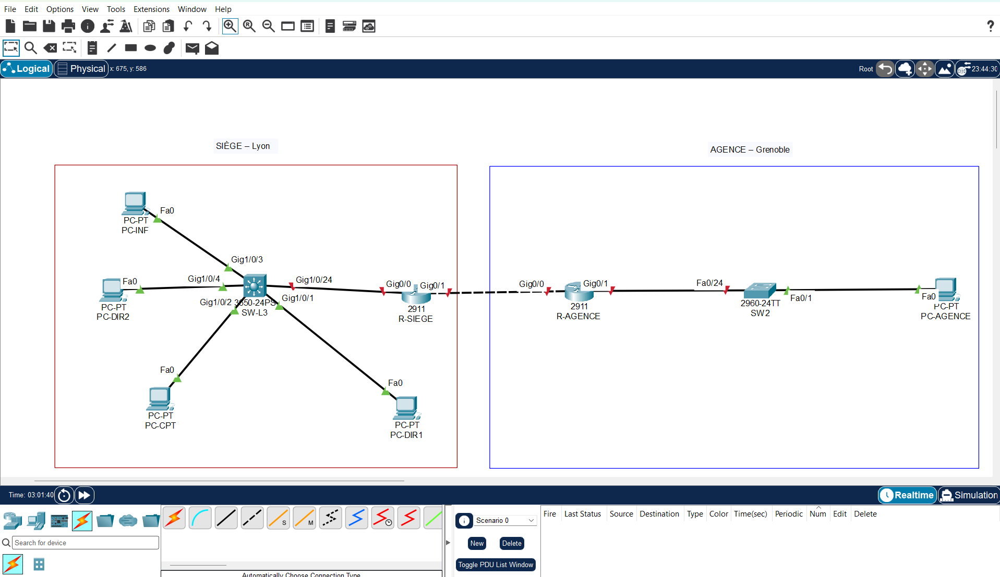

# 02 – Construction de la topologie

## Objectif
Je place les équipements des deux sites dans Packet Tracer et je les relie par des câbles. Je prépare ainsi le réseau avant de le configurer.

## Équipements
| Nom | Modèle | Rôle | Site |
|---|---|---|---|
| R-SIEGE | Routeur 2911 | Relie le siège à l'agence | Siège (Lyon) |
| SW-L3 | Switch 3650-24PS | Switch de niveau 3, prévu pour le routage entre VLAN | Siège (Lyon) |
| PC-DIR1, PC-DIR2 | PC | Postes du service Direction | Siège (Lyon) |
| PC-CPT | PC | Poste du service Comptabilité | Siège (Lyon) |
| PC-INF | PC | Poste du service Informatique | Siège (Lyon) |
| R-AGENCE | Routeur 2911 | Relie l'agence au siège | Agence (Grenoble) |
| SW2 | Switch 2960-24TT | Switch de l'agence | Agence (Grenoble) |
| PC-AGENCE | PC | Poste de l'agence | Agence (Grenoble) |

## Procédure
1. Je place les 9 équipements dans l'espace de travail : 2 routeurs, 2 switchs et 5 PC.
2. Je donne à chaque équipement le nom prévu dans le tableau ci-dessus.
3. Je remplace le switch du siège par un modèle **3650-24PS**, car un 2960 ne sait pas faire de routage.
4. J'installe le module d'alimentation `AC-POWER-SUPPLY` dans le 3650-24PS (onglet **Physical**), sinon il ne s'allume pas.
5. J'affiche les noms de ports sur les câbles : **Options > Preferences > Interface > Always Show Port Labels in Logical Workspace**.
6. Je relie les équipements avec l'outil **Connections**, en choisissant moi-même le type de câble.
7. J'entoure chaque site d'un rectangle de couleur et j'ajoute son nom avec **Place Note**.
8. J'enregistre le fichier `.pkt`.

## Câblage
| Câble | Extrémité A | Extrémité B | Type de câble |
|---|---|---|---|
| 1 | PC-DIR1 `Fa0` | SW-L3 `Gig1/0/1` | droit |
| 2 | PC-CPT `Fa0` | SW-L3 `Gig1/0/2` | droit |
| 3 | PC-INF `Fa0` | SW-L3 `Gig1/0/3` | droit |
| 4 | PC-DIR2 `Fa0` | SW-L3 `Gig1/0/4` | droit |
| 5 | SW-L3 `Gig1/0/24` | R-SIEGE `Gig0/0` | droit |
| 6 | R-SIEGE `Gig0/1` | R-AGENCE `Gig0/0` | croisé |
| 7 | R-AGENCE `Gig0/1` | SW2 `Fa0/24` | droit |
| 8 | PC-AGENCE `Fa0` | SW2 `Fa0/1` | droit |

Je choisis un câble **croisé** entre les deux routeurs, car ce sont deux équipements de même nature. J'utilise un câble **droit** entre équipements de nature différente (PC et switch, switch et routeur).

## Vérification
- Les liens entre les PC et les switchs sont **verts**.
- Les liens vers les routeurs sont **rouges** : les interfaces des routeurs sont désactivées par défaut. Je les active à l'étape de configuration des routeurs.

## Preuve
| Capture | Ce qu'elle montre |
|---|---|
|  | Les deux sites encadrés (Siège – Lyon, Agence – Grenoble), les 9 équipements, les 8 câbles et le nom de chaque port. |

## Fichier du laboratoire
Le fichier Packet Tracer est dans [`packet-tracer/`](../packet-tracer/).
