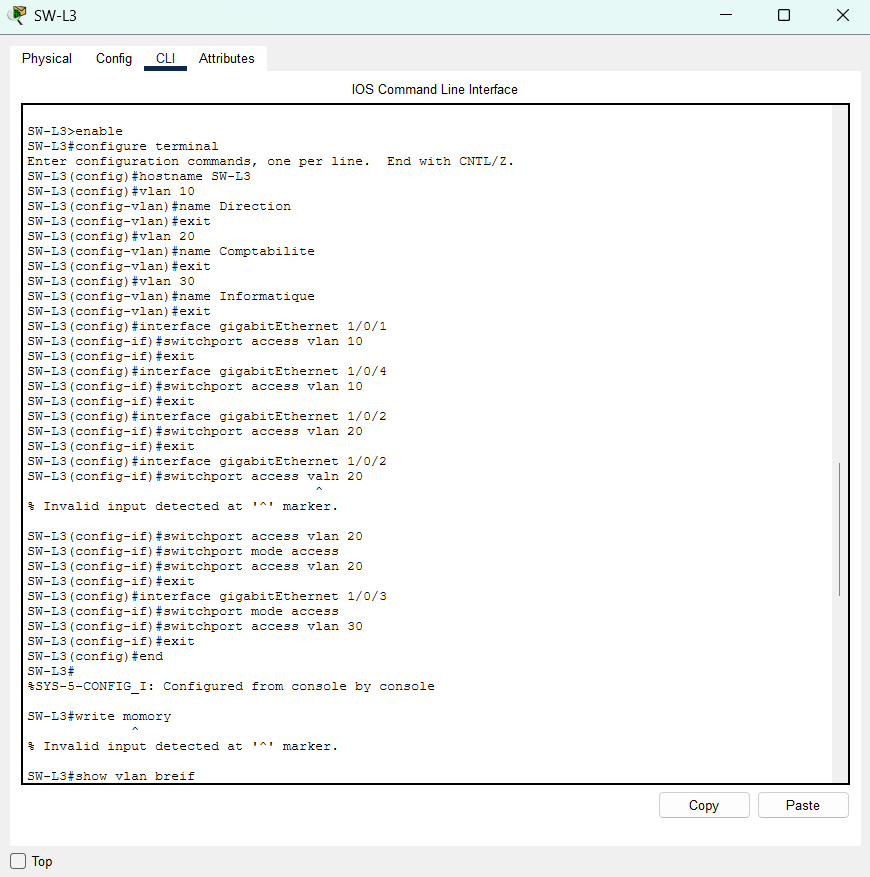
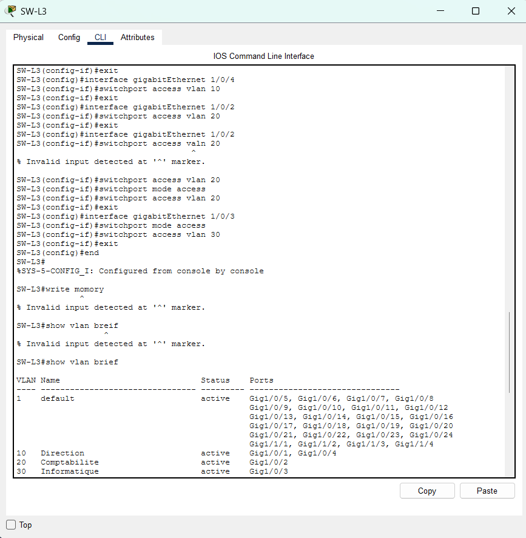
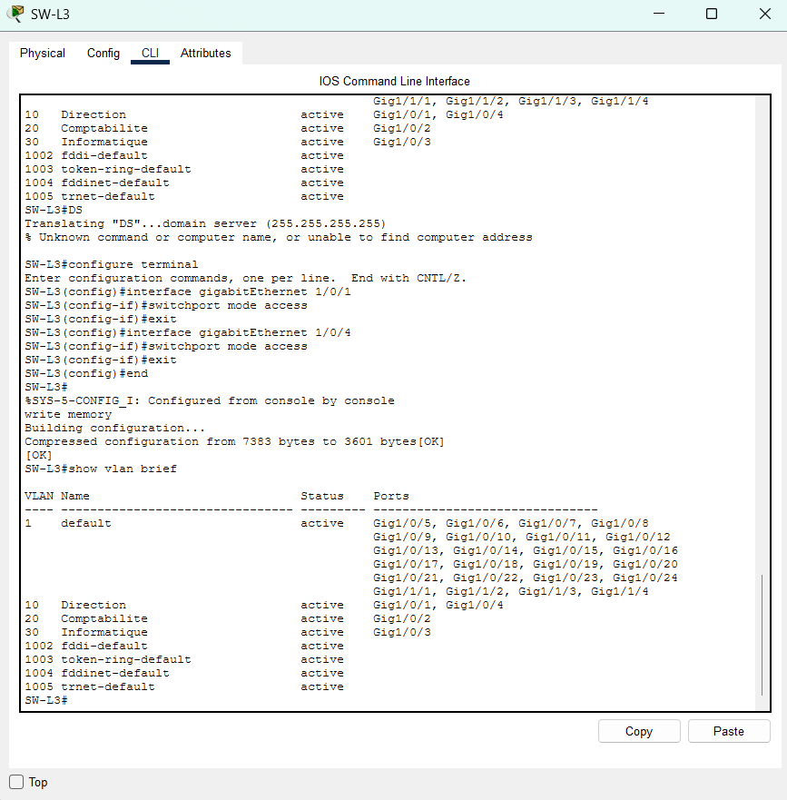

# 03 – Création des VLAN

## Objectif
Je sépare les trois services du siège sur le switch `SW-L3` : Direction, Comptabilité et Informatique. Je crée un VLAN par service et j'affecte les ports des postes.

## Plan des VLAN
| VLAN | Nom | Ports de `SW-L3` | Poste |
|---|---|---|---|
| 10 | Direction | `Gig1/0/1`, `Gig1/0/4` | PC-DIR1, PC-DIR2 |
| 20 | Comptabilite | `Gig1/0/2` | PC-CPT |
| 30 | Informatique | `Gig1/0/3` | PC-INF |

Je n'écris pas d'accent dans les noms de VLAN pour éviter les problèmes d'affichage.

## Procédure

### 1. Ouvrir la CLI
J'ouvre la CLI de `SW-L3` (onglet **CLI**).

### 2. Nommer le switch
```
enable
configure terminal
hostname SW-L3
```

### 3. Créer les trois VLAN
```
vlan 10
name Direction
exit
vlan 20
name Comptabilite
exit
vlan 30
name Informatique
exit
```

### 4. Affecter les ports en mode accès
Exemple pour le port `Gig1/0/1` :
```
interface gigabitEthernet 1/0/1
switchport mode access
switchport access vlan 10
exit
```
Je répète pour `Gig1/0/4` (VLAN 10), `Gig1/0/2` (VLAN 20) et `Gig1/0/3` (VLAN 30).

### 5. Enregistrer la configuration
```
end
write memory
```

## Vérification
Je tape `show vlan brief`. Je vérifie que :
- le VLAN 10 `Direction` contient `Gig1/0/1` et `Gig1/0/4` ;
- le VLAN 20 `Comptabilite` contient `Gig1/0/2` ;
- le VLAN 30 `Informatique` contient `Gig1/0/3` ;
- `write memory` affiche `[OK]`.

## Difficultés rencontrées
| Difficulté | Preuve | Ce que j'ai fait |
|---|---|---|
| Faute de frappe `valn` au lieu de `vlan` : `% Invalid input detected` | `03-erreur-saisie.png` | Je relis la commande, je la retape correctement. |
| Faute de frappe `write momory` : `% Invalid input detected`, la configuration n'est pas enregistrée | `03-erreur-saisie.png` | Je retape `write memory` ; le message `[OK]` confirme l'enregistrement. |
| J'ai oublié `switchport mode access` sur `Gig1/0/1` et `Gig1/0/4` | `03-creation-vlan.png` | J'ajoute la commande sur ces deux ports. |

## Preuves
| Capture | Ce qu'elle montre |
|---|---|
|  | La CLI de `SW-L3` : `hostname SW-L3`, création des VLAN 10, 20 et 30, affectation des ports `Gig1/0/1`, `Gig1/0/4`, `Gig1/0/2`, `Gig1/0/3` et l'erreur sur la commande `switchport access valn 20`. |
|  | Les messages `% Invalid input detected` pour `switchport access valn 20`, `write momory` et `show vlan breif`, puis `show vlan brief` avec les VLAN 10, 20 et 30. |
|  | `switchport mode access` ajouté sur `Gig1/0/1` et `Gig1/0/4`, `write memory` suivi de `[OK]`, puis `show vlan brief` avec les quatre ports dans les bons VLAN. |
