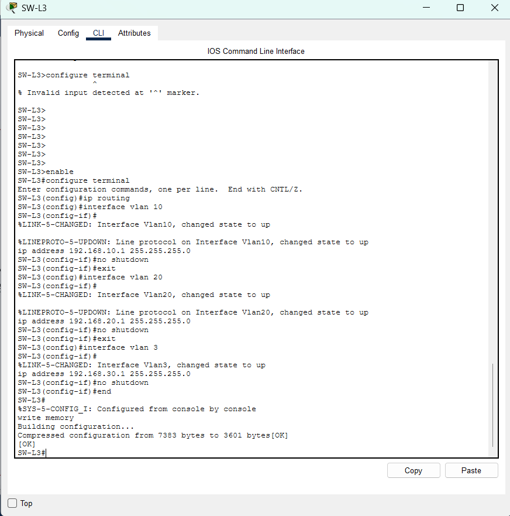
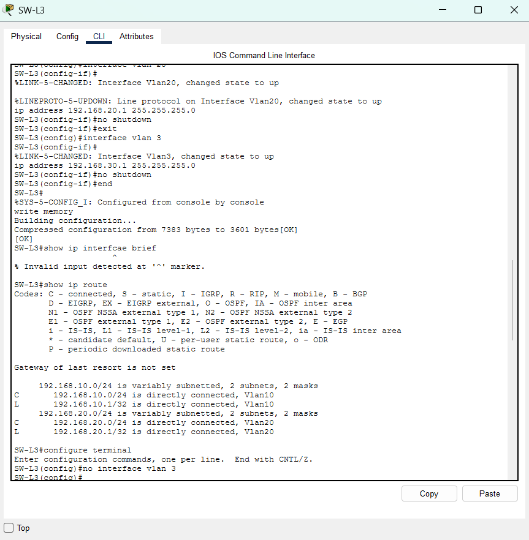
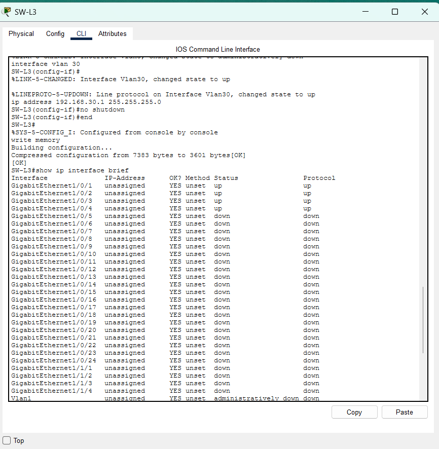
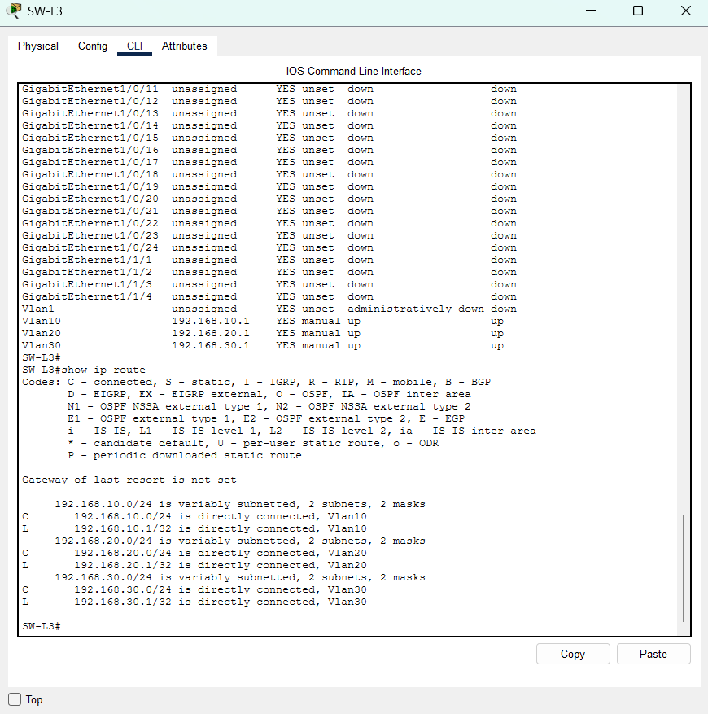

# 04 – Routage entre VLAN

## Objectif
Je configure `SW-L3` pour qu'il route entre les trois VLAN du siège. Je donne à chaque VLAN une adresse de passerelle sur une interface virtuelle (SVI).

## Plan d'adressage des SVI
| VLAN | Interface | Adresse IP | Masque |
|---|---|---|---|
| 10 | `Vlan10` | `192.168.10.1` | `255.255.255.0` |
| 20 | `Vlan20` | `192.168.20.1` | `255.255.255.0` |
| 30 | `Vlan30` | `192.168.30.1` | `255.255.255.0` |

## Procédure

### 1. Passer en mode configuration
```
enable
configure terminal
```

### 2. Activer le routage
```
ip routing
```

### 3. Créer les interfaces virtuelles
Exemple pour le VLAN 10 :
```
interface vlan 10
ip address 192.168.10.1 255.255.255.0
no shutdown
exit
```
Je répète pour `interface vlan 20` (`192.168.20.1`) et `interface vlan 30` (`192.168.30.1`).

### 4. Enregistrer la configuration
```
end
write memory
```

## Vérification
Je tape `show ip interface brief` et `show ip route`. Je vérifie que :
- `Vlan10`, `Vlan20` et `Vlan30` ont les adresses prévues et sont `up` / `up` ;
- `show ip route` affiche une ligne `C` pour `192.168.10.0/24`, `192.168.20.0/24` et `192.168.30.0/24` ;
- `write memory` affiche `[OK]`.

## Difficultés rencontrées
| Difficulté | Preuve | Ce que j'ai fait |
|---|---|---|
| J'ai tapé `configure terminal` en mode utilisateur (`SW-L3>`) : `% Invalid input detected` | `04-configuration-svi.png` | Je tape `enable` pour passer en mode privilégié (`SW-L3#`). |
| J'ai tapé `interface vlan 3` au lieu de `interface vlan 30` : `show ip route` n'affiche pas le réseau `192.168.30.0/24` | `04-configuration-svi.png`, `04-route-incomplet-correction.png` | Je supprime l'interface avec `no interface vlan 3`, puis je configure `interface vlan 30`. |
| Faute de frappe `show ip interfcae brief` : `% Invalid input detected` | `04-route-incomplet-correction.png` | Je retape la commande correctement. |

## Preuves
| Capture | Ce qu'elle montre |
|---|---|
|  | `configure terminal` refusé sur `SW-L3>`, puis `enable`, `configure terminal`, `ip routing`, `interface vlan 10` (`192.168.10.1`), `interface vlan 20` (`192.168.20.1`), `interface vlan 3` (`192.168.30.1`) et `write memory` suivi de `[OK]`. |
|  | `show ip interfcae brief` refusé, `show ip route` avec seulement `Vlan10` et `Vlan20`, puis `configure terminal` et `no interface vlan 3`. |
|  | `interface vlan 30`, `ip address 192.168.30.1 255.255.255.0`, `no shutdown`, `write memory` suivi de `[OK]`, puis le début de `show ip interface brief`. |
|  | `show ip interface brief` avec `Vlan10`, `Vlan20` et `Vlan30` en `up` / `up`, puis `show ip route` avec les trois réseaux `192.168.10.0/24`, `192.168.20.0/24` et `192.168.30.0/24`. |
