# 05 – Routeurs et routage entre les deux sites

## Objectif
Je configure les deux routeurs et la liaison de `SW-L3` vers le routeur du siège. J'écris des routes statiques pour relier le siège et l'agence.

## Plan d'adressage des liaisons
| Équipement | Interface | Adresse IP | Masque |
|---|---|---|---|
| `SW-L3` | `Gig1/0/24` | `10.0.1.2` | `255.255.255.252` |
| `R-SIEGE` | `Gig0/0` | `10.0.1.1` | `255.255.255.252` |
| `R-SIEGE` | `Gig0/1` | `10.0.0.1` | `255.255.255.252` |
| `R-AGENCE` | `Gig0/0` | `10.0.0.2` | `255.255.255.252` |
| `R-AGENCE` | `Gig0/1` | `192.168.40.1` | `255.255.255.0` |

## Routes statiques
| Équipement | Réseau de destination | Saut suivant |
|---|---|---|
| `R-SIEGE` | `192.168.10.0/24`, `192.168.20.0/24`, `192.168.30.0/24` | `10.0.1.2` |
| `R-SIEGE` | `192.168.40.0/24` | `10.0.0.2` |
| `R-AGENCE` | `0.0.0.0/0` (route par défaut) | `10.0.0.1` |
| `SW-L3` | `0.0.0.0/0` (route par défaut) | `10.0.1.1` |

## Procédure

### 1. Configurer `R-SIEGE`
```
enable
configure terminal
hostname R-SIEGE
no router rip
interface gigabitEthernet 0/0
ip address 10.0.1.1 255.255.255.252
no shutdown
exit
interface gigabitEthernet 0/1
ip address 10.0.0.1 255.255.255.252
no shutdown
exit
ip route 192.168.10.0 255.255.255.0 10.0.1.2
ip route 192.168.20.0 255.255.255.0 10.0.1.2
ip route 192.168.30.0 255.255.255.0 10.0.1.2
ip route 192.168.40.0 255.255.255.0 10.0.0.2
end
write memory
```

### 2. Configurer `R-AGENCE`
```
enable
configure terminal
hostname R-AGENCE
interface gigabitEthernet 0/0
ip address 10.0.0.2 255.255.255.252
no shutdown
exit
interface gigabitEthernet 0/1
ip address 192.168.40.1 255.255.255.0
no shutdown
exit
ip route 0.0.0.0 0.0.0.0 10.0.0.1
end
write memory
```

### 3. Configurer la liaison de `SW-L3`
```
enable
configure terminal
interface gigabitEthernet 1/0/24
no switchport
ip address 10.0.1.2 255.255.255.252
no shutdown
exit
ip route 0.0.0.0 0.0.0.0 10.0.1.1
end
write memory
```

## Vérification
Sur chaque équipement, je tape `show ip interface brief` et `show ip route`. Je vérifie que :
- les interfaces configurées sont `up` / `up` ;
- `R-SIEGE` affiche `C 10.0.0.0/30`, `C 10.0.1.0/30`, trois routes `S` vers les VLAN et `S 192.168.40.0/24` via `10.0.0.2` ;
- `R-AGENCE` et `SW-L3` affichent une route par défaut `S*` ;
- `show running-config | include rip` n'affiche aucune ligne sur `R-SIEGE`.

## Tests de connectivité
| Depuis | Commande | Résultat | Preuve |
|---|---|---|---|
| `R-SIEGE` | `ping 10.0.0.2` | 80 % (4/5) | `05-ping-r-siege.png` |
| `R-SIEGE` | `ping 10.0.1.2` | 100 % (5/5) | `05-ping-r-siege.png` |
| `R-AGENCE` | `ping 192.168.10.1` | 80 % (4/5) | `05-verification-r-agence.png` |
| `SW-L3` | `ping 192.168.40.1` | 100 % (5/5) | `05-ping-sw-l3.png` |

Le premier paquet d'un ping sert à retrouver l'adresse du voisin : le `.` au début de la ligne est normal.

## Difficultés rencontrées
| Difficulté | Preuve | Ce que j'ai fait |
|---|---|---|
| J'ai tapé les commandes de `R-AGENCE` dans la fenêtre de `R-SIEGE` : le routeur du siège a pris le nom `R-AGENCE` | `05-erreur-mauvais-routeur.png` | Je lis le titre de la fenêtre et l'invite avant de taper, puis je remets le nom `R-SIEGE`. |
| Masque `255.255.255.255` au lieu de `255.255.255.252` : `Bad mask /32 for address 10.0.0.2` | `05-erreur-mauvais-routeur.png` | Je retape l'adresse avec le masque `255.255.255.252`. |
| Points à la place des espaces dans `ip route 0.0.0.0 0.0.0.0 10.0.0.1` : `% Invalid input detected` | `05-erreur-mauvais-routeur.png`, `05-config-r-agence.png`, `05-verification-r-agence.png` | Je tape trois groupes séparés par des espaces et je relis la ligne avant de valider. |
| Point en trop après le deuxième `0.0.0.0` sur `SW-L3` : `% Invalid input detected` | `05-config-sw-l3.png` | Je retape la commande sans le point. |
| J'ai retapé `hostname R-AGENCE` sur `R-SIEGE` et écrit la route `192.168.40.0/24` via `10.0.1.2` au lieu de `10.0.0.2` | `05-erreur-hostname-route.png` | Je tape `hostname R-SIEGE`, je supprime la route avec `no ip route` et j'écris la bonne (`05-correction-r-siege.png`). |
| J'ai tapé `router rip` : le protocole RIP est activé alors que j'utilise le routage statique | `05-erreur-rip.png` | Je tape `no router rip`. `show running-config \| include rip` n'affiche plus aucune ligne (`05-ping-r-siege.png`). |
| Je suis entré dans le mode `R-SIEGE(vlan)#` : `end` est refusé | `05-erreur-rip.png` | Je tape `exit` pour revenir en `R-SIEGE#`. |

## Preuves
| Capture | Ce qu'elle montre |
|---|---|
| 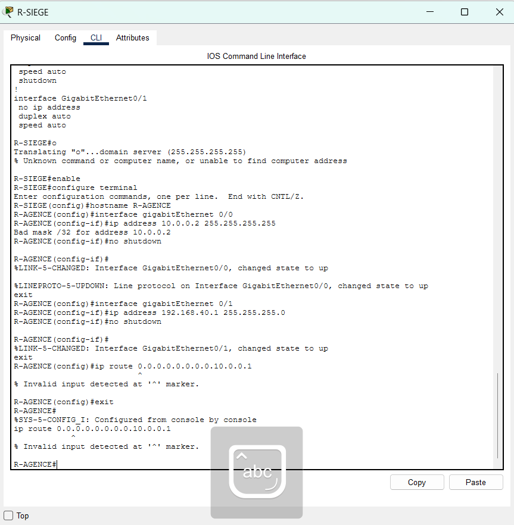 | Dans la fenêtre `R-SIEGE` : `hostname R-AGENCE`, le message `Bad mask /32 for address 10.0.0.2` et `ip route 0.0.0.0.0.0.0.0.10.0.0.1` refusé. |
| 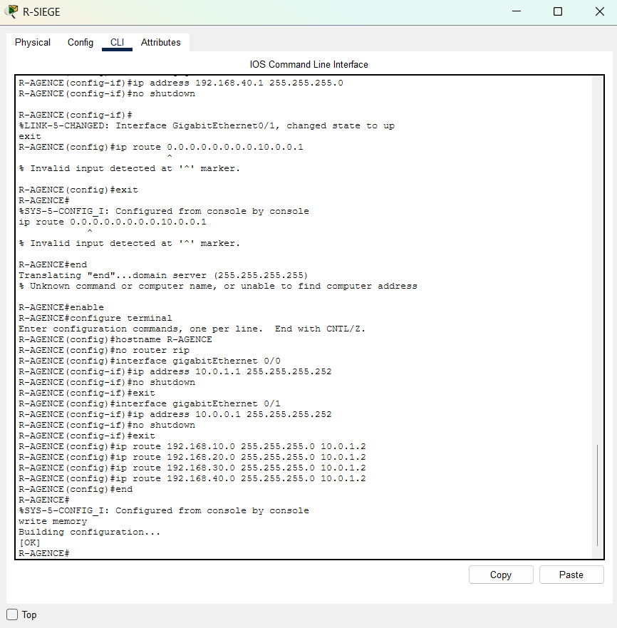 | Dans la fenêtre `R-SIEGE` : `hostname R-AGENCE` retapé, quatre routes dont `192.168.40.0/24` via `10.0.1.2`, puis `write memory` suivi de `[OK]`. |
| 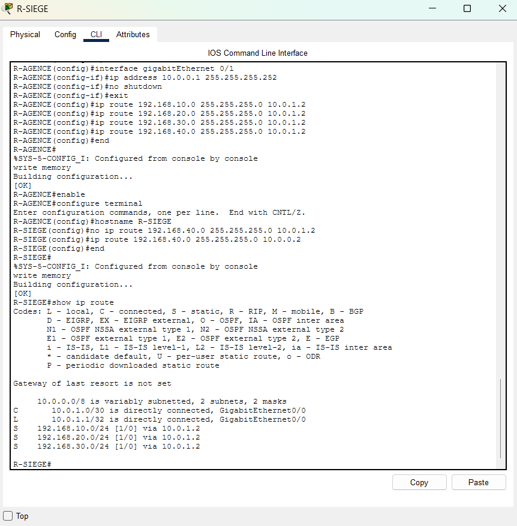 | `hostname R-SIEGE`, `no ip route 192.168.40.0 ... 10.0.1.2`, `ip route 192.168.40.0 ... 10.0.0.2`, puis `show ip route` avec `C 10.0.1.0/30` et trois routes `S`, sans réseau de l'agence. |
| 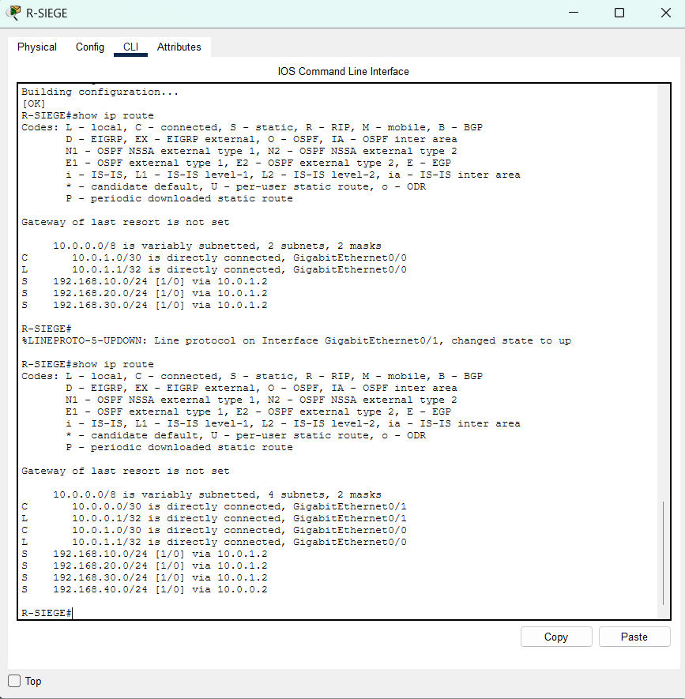 | `show ip route` avant puis après le message `GigabitEthernet0/1, changed state to up` : `C 10.0.0.0/30` et `S 192.168.40.0/24 via 10.0.0.2` apparaissent. |
| 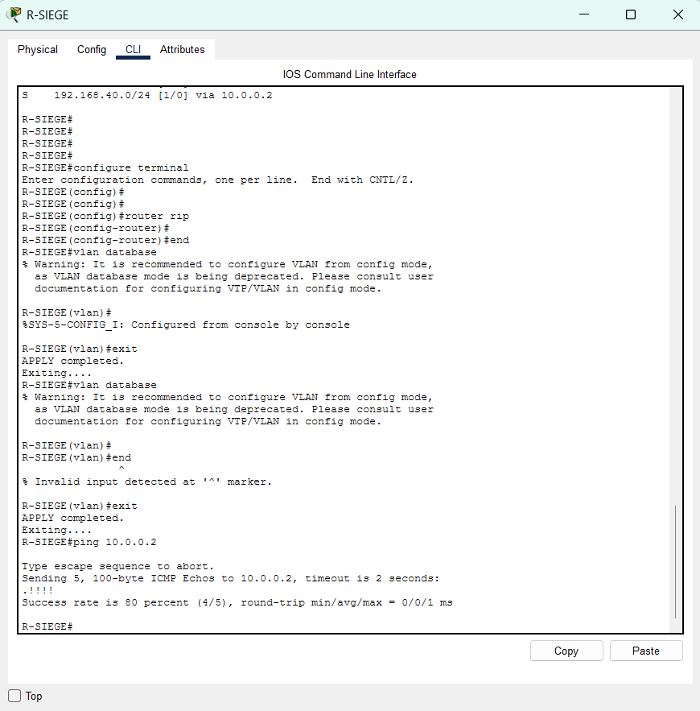 | `router rip` puis `end`, le mode `vlan database` avec `end` refusé, puis `ping 10.0.0.2` à 80 %. |
| 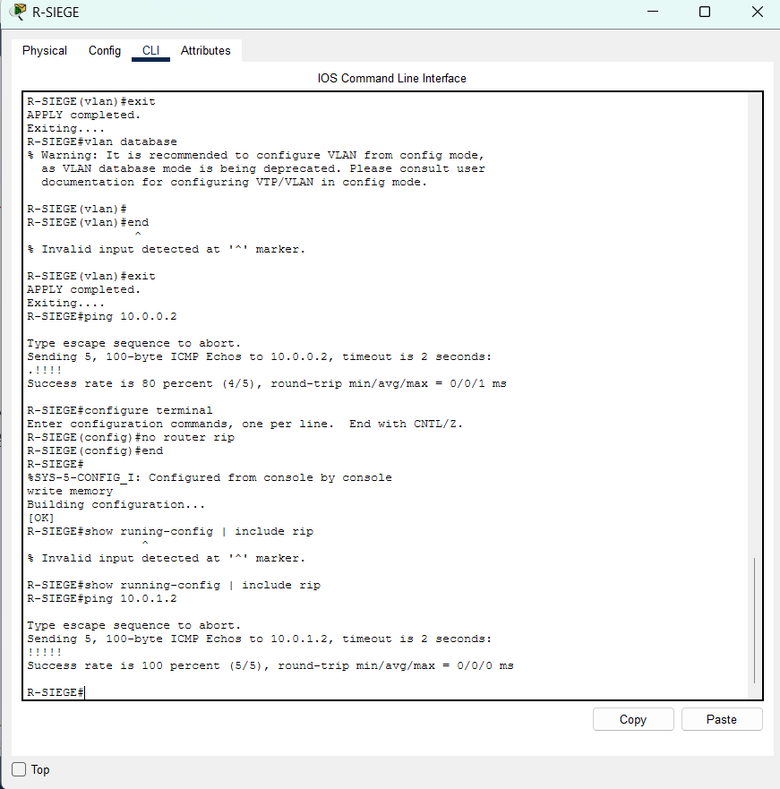 | `no router rip`, `write memory` suivi de `[OK]`, `show running-config \| include rip` sans ligne affichée, puis `ping 10.0.1.2` à 100 %. |
| 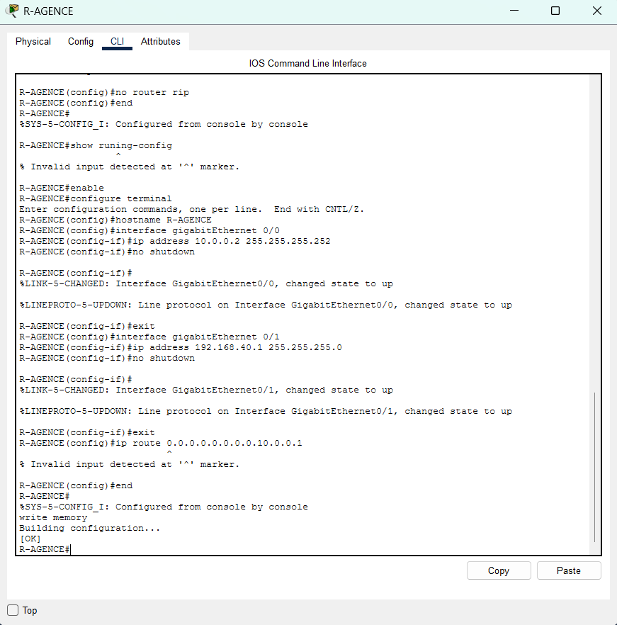 | `Gig0/0` (`10.0.0.2`) et `Gig0/1` (`192.168.40.1`) passent à `up`, puis `ip route 0.0.0.0.0.0.0.0.10.0.0.1` refusé. |
| 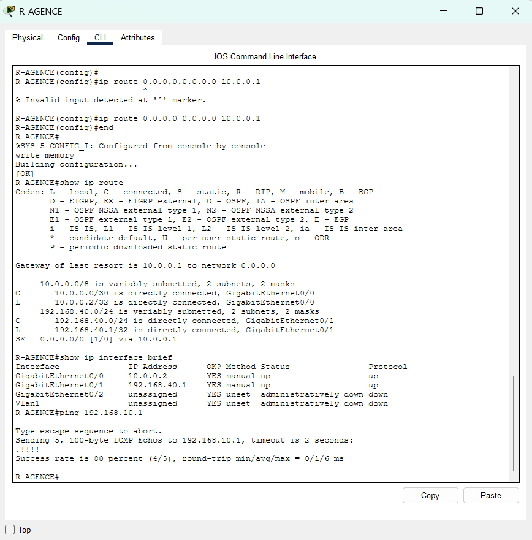 | Route par défaut acceptée à la 3ᵉ tentative, `show ip route` avec `S* 0.0.0.0/0 via 10.0.0.1`, `show ip interface brief` avec `10.0.0.2` et `192.168.40.1` en `up` / `up`, puis `ping 192.168.10.1` à 80 %. |
| 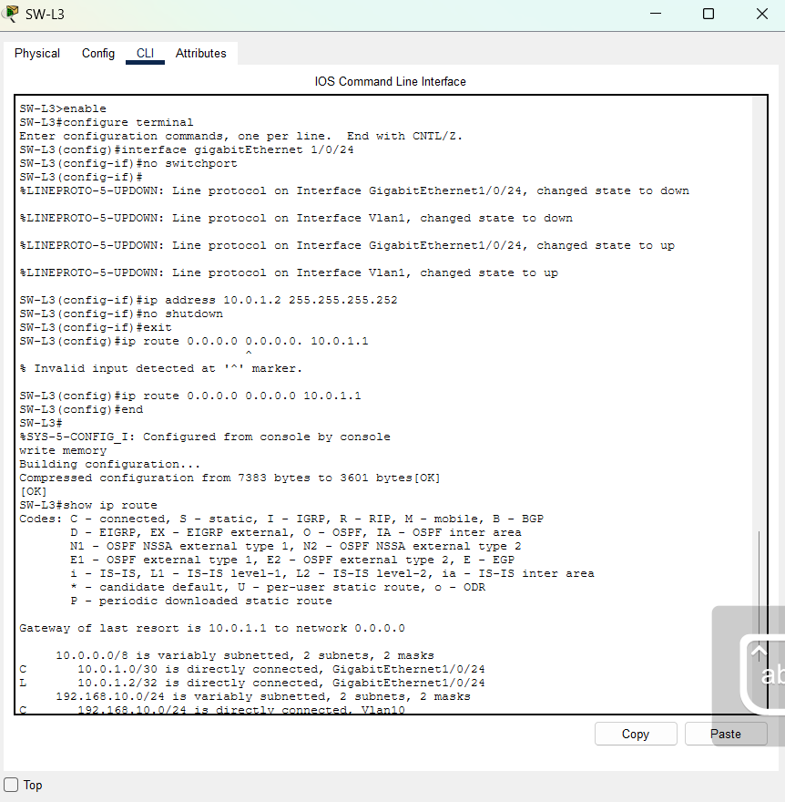 | `no switchport`, `ip address 10.0.1.2 255.255.255.252`, route par défaut refusée (point en trop) puis acceptée, et `write memory` suivi de `[OK]`. |
| 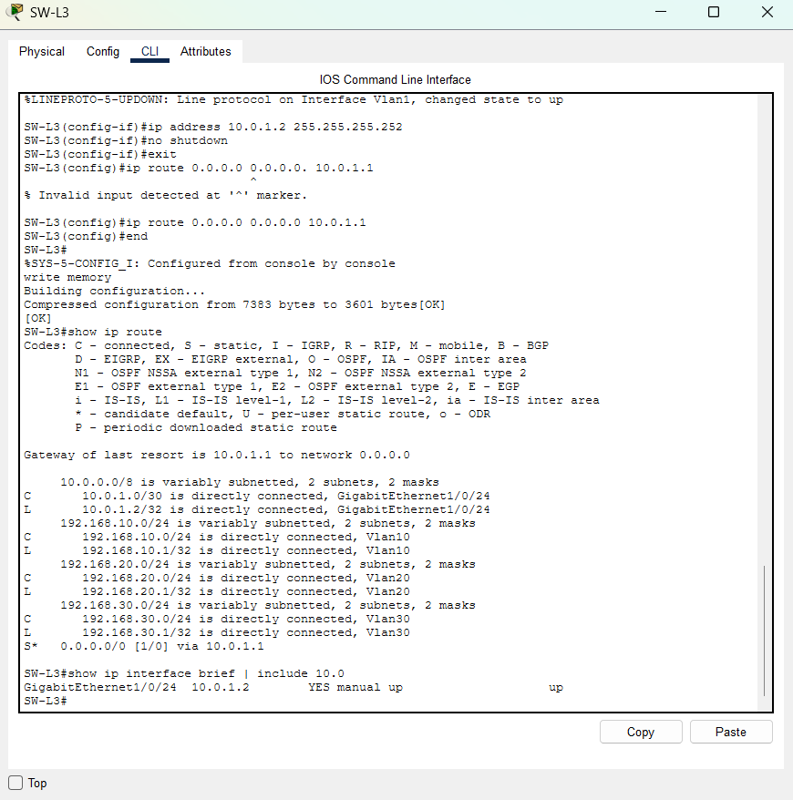 | `show ip route` avec `C 10.0.1.0/30`, les trois réseaux de VLAN et `S* 0.0.0.0/0 via 10.0.1.1`, puis `GigabitEthernet1/0/24` `10.0.1.2` en `up` / `up`. |
| 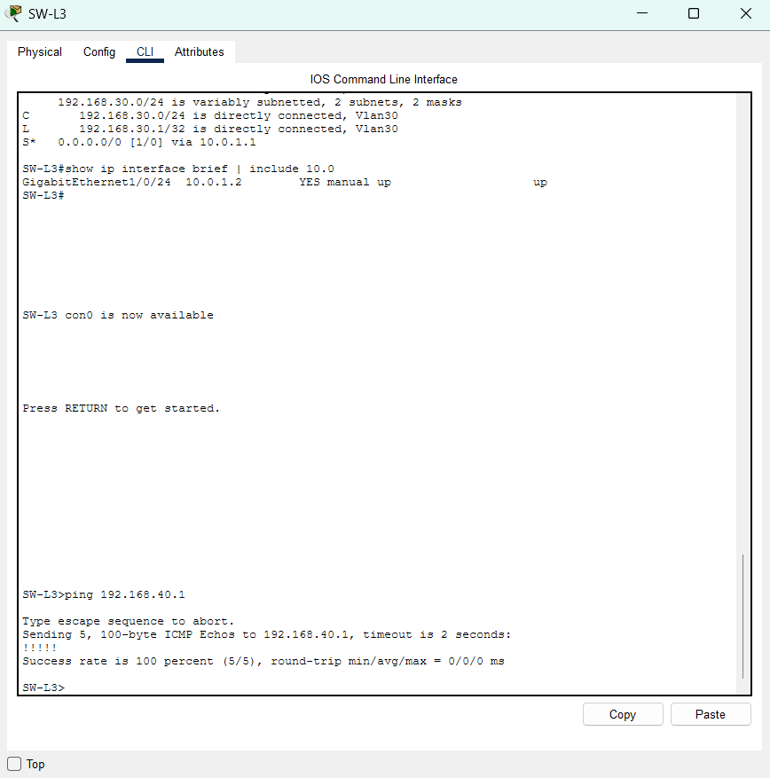 | `ping 192.168.40.1` depuis `SW-L3` : `!!!!!`, 100 %. |
