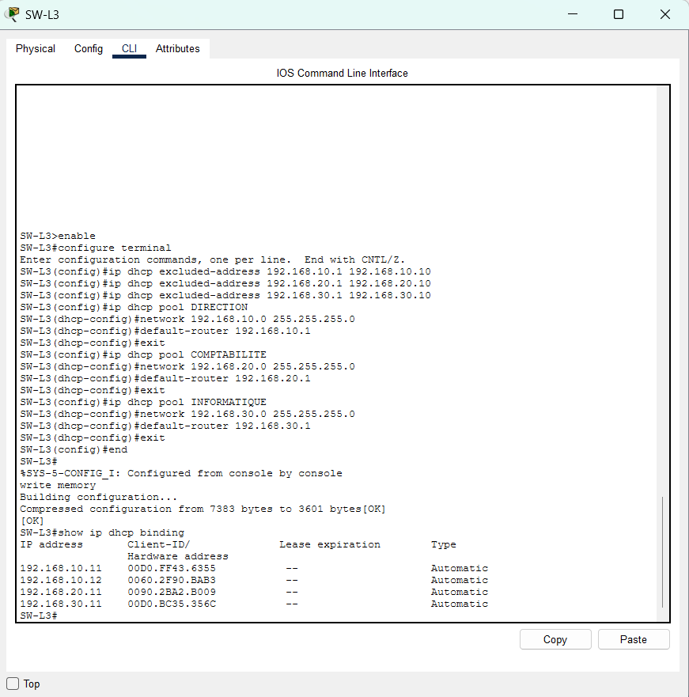
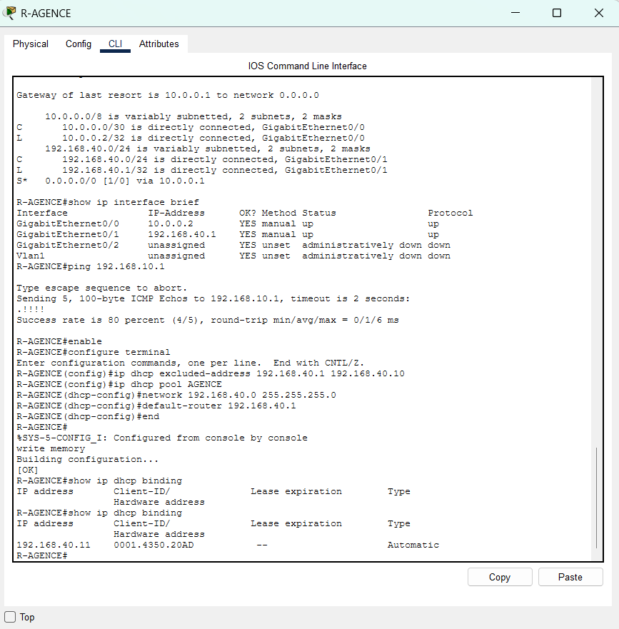
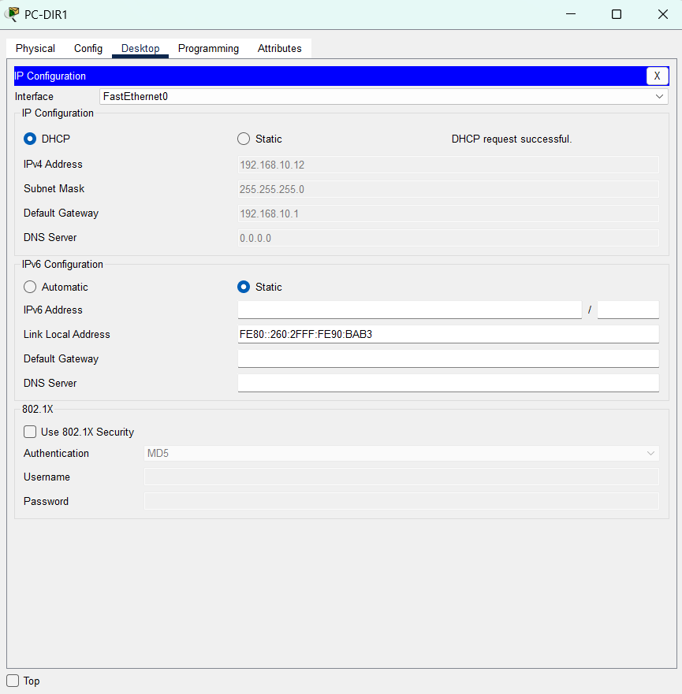
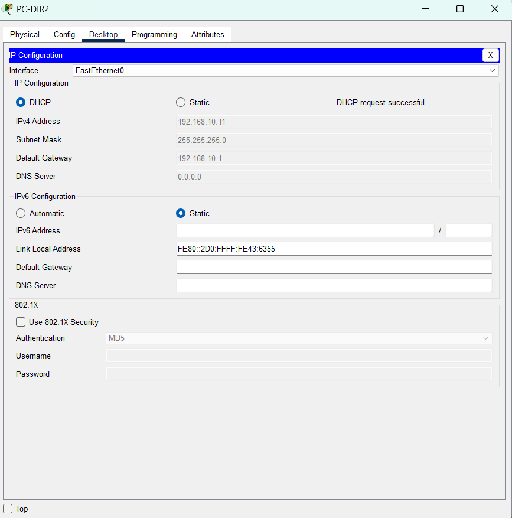
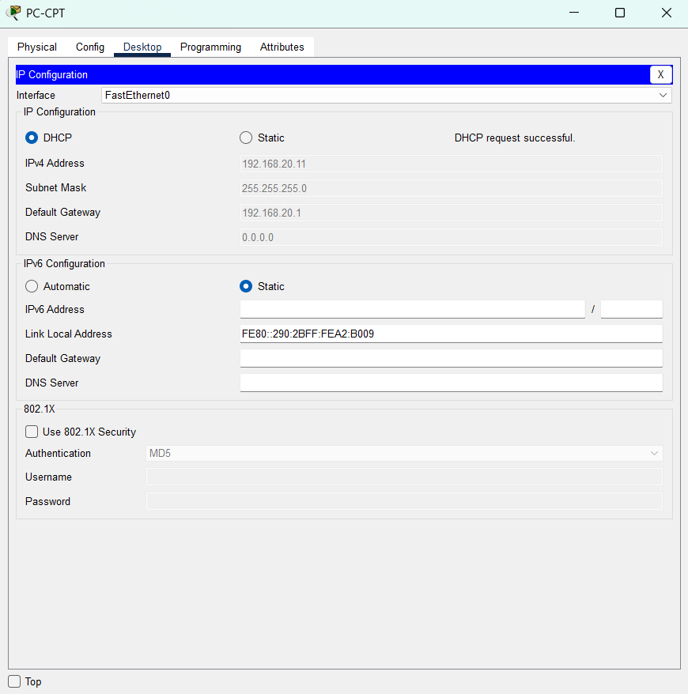
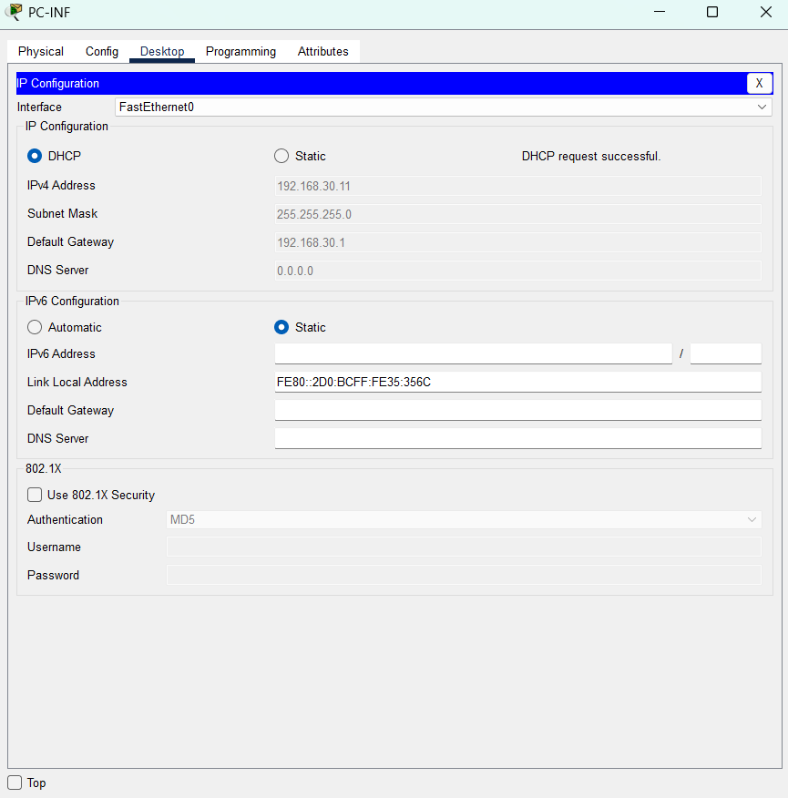
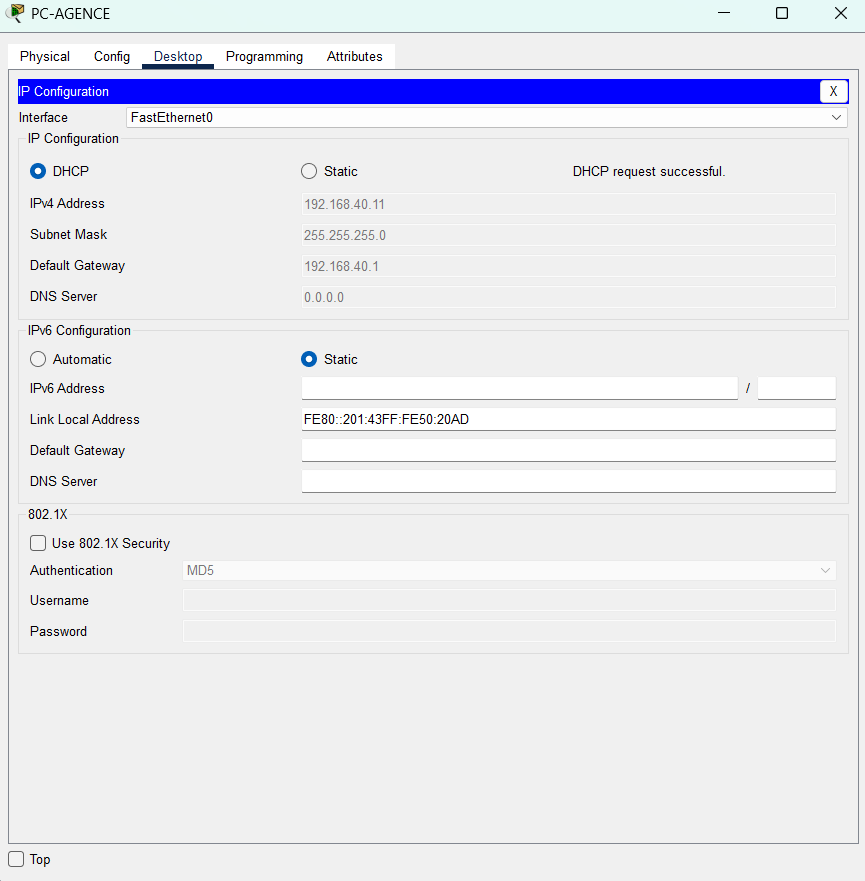

# 06 – Configuration du DHCP

## Objectif
Je configure le DHCP pour que les postes reçoivent leur adresse IP, leur masque et leur passerelle automatiquement.

## Plan DHCP
| Équipement | Pool | Réseau | Passerelle | Adresses exclues |
|---|---|---|---|---|
| `SW-L3` | `DIRECTION` | `192.168.10.0/24` | `192.168.10.1` | `192.168.10.1` à `192.168.10.10` |
| `SW-L3` | `COMPTABILITE` | `192.168.20.0/24` | `192.168.20.1` | `192.168.20.1` à `192.168.20.10` |
| `SW-L3` | `INFORMATIQUE` | `192.168.30.0/24` | `192.168.30.1` | `192.168.30.1` à `192.168.30.10` |
| `R-AGENCE` | `AGENCE` | `192.168.40.0/24` | `192.168.40.1` | `192.168.40.1` à `192.168.40.10` |

Les pools du siège sont sur `SW-L3`, qui porte déjà les passerelles des VLAN. Le pool de l'agence est sur `R-AGENCE`. Je n'ai pas configuré de serveur DNS : le champ DNS des postes reste `0.0.0.0`.

## Procédure

### 1. Configurer le DHCP sur `SW-L3`
```
enable
configure terminal
ip dhcp excluded-address 192.168.10.1 192.168.10.10
ip dhcp excluded-address 192.168.20.1 192.168.20.10
ip dhcp excluded-address 192.168.30.1 192.168.30.10
ip dhcp pool DIRECTION
network 192.168.10.0 255.255.255.0
default-router 192.168.10.1
exit
ip dhcp pool COMPTABILITE
network 192.168.20.0 255.255.255.0
default-router 192.168.20.1
exit
ip dhcp pool INFORMATIQUE
network 192.168.30.0 255.255.255.0
default-router 192.168.30.1
exit
end
write memory
```

### 2. Configurer le DHCP sur `R-AGENCE`
```
enable
configure terminal
ip dhcp excluded-address 192.168.40.1 192.168.40.10
ip dhcp pool AGENCE
network 192.168.40.0 255.255.255.0
default-router 192.168.40.1
end
write memory
```

### 3. Passer les postes en DHCP
Pour chaque poste : je clique sur le poste, onglet **Desktop**, **IP Configuration**, puis je choisis **DHCP**.

## Vérification
- Chaque poste affiche `DHCP request successful`, une adresse dans son réseau, le masque `255.255.255.0` et la bonne passerelle.
- `show ip dhcp binding` sur `SW-L3` et sur `R-AGENCE` liste les adresses distribuées.

## Résultats
| Poste | Réseau | Adresse reçue | Passerelle | Preuve |
|---|---|---|---|---|
| `PC-DIR1` | Direction (VLAN 10) | `192.168.10.12` | `192.168.10.1` | `06-pc-dir1.png` |
| `PC-DIR2` | Direction (VLAN 10) | `192.168.10.11` | `192.168.10.1` | `06-pc-dir2.png` |
| `PC-CPT` | Comptabilité (VLAN 20) | `192.168.20.11` | `192.168.20.1` | `06-pc-cpt.png` |
| `PC-INF` | Informatique (VLAN 30) | `192.168.30.11` | `192.168.30.1` | `06-pc-inf.png` |
| `PC-AGENCE` | Agence | `192.168.40.11` | `192.168.40.1` | `06-pc-agence.png` |

## Preuves
| Capture | Ce qu'elle montre |
|---|---|
|  | Sur `SW-L3` : les 3 adresses exclues, les pools `DIRECTION`, `COMPTABILITE` et `INFORMATIQUE` avec leur réseau et leur passerelle, `write memory` suivi de `[OK]`, puis `show ip dhcp binding` avec `192.168.10.11`, `192.168.10.12`, `192.168.20.11` et `192.168.30.11` (type `Automatic`). |
|  | Sur `R-AGENCE` : l'adresse exclue, le pool `AGENCE`, `write memory` suivi de `[OK]`, un premier `show ip dhcp binding` vide, puis un second avec `192.168.40.11` (type `Automatic`). |
|  | `PC-DIR1` : DHCP sélectionné, `DHCP request successful`, adresse `192.168.10.12`, masque `255.255.255.0`, passerelle `192.168.10.1`. |
|  | `PC-DIR2` : DHCP sélectionné, `DHCP request successful`, adresse `192.168.10.11`, masque `255.255.255.0`, passerelle `192.168.10.1`. |
|  | `PC-CPT` : DHCP sélectionné, `DHCP request successful`, adresse `192.168.20.11`, masque `255.255.255.0`, passerelle `192.168.20.1`. |
|  | `PC-INF` : DHCP sélectionné, `DHCP request successful`, adresse `192.168.30.11`, masque `255.255.255.0`, passerelle `192.168.30.1`. |
|  | `PC-AGENCE` : DHCP sélectionné, `DHCP request successful`, adresse `192.168.40.11`, masque `255.255.255.0`, passerelle `192.168.40.1`. |
