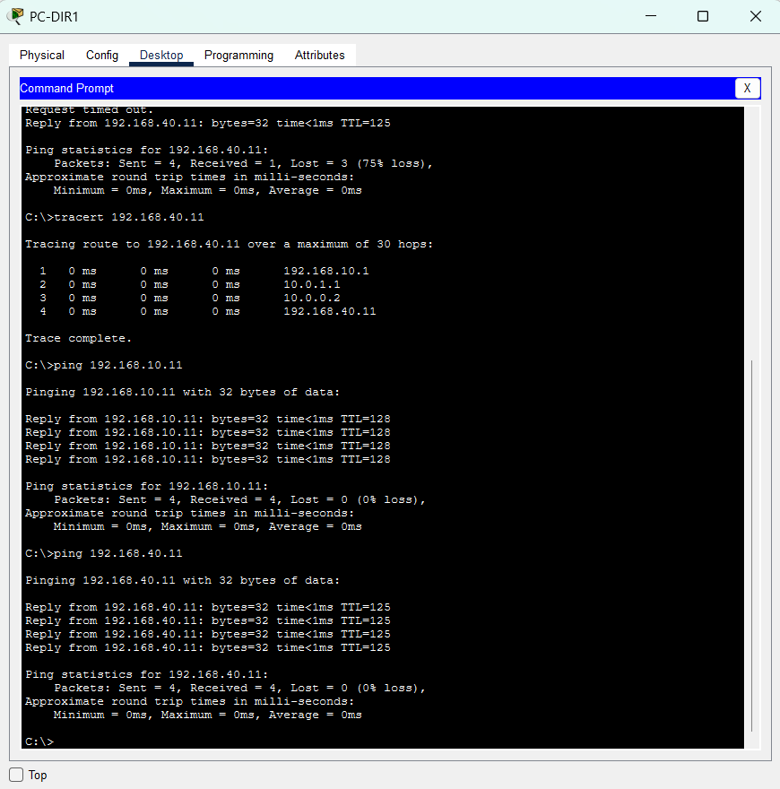
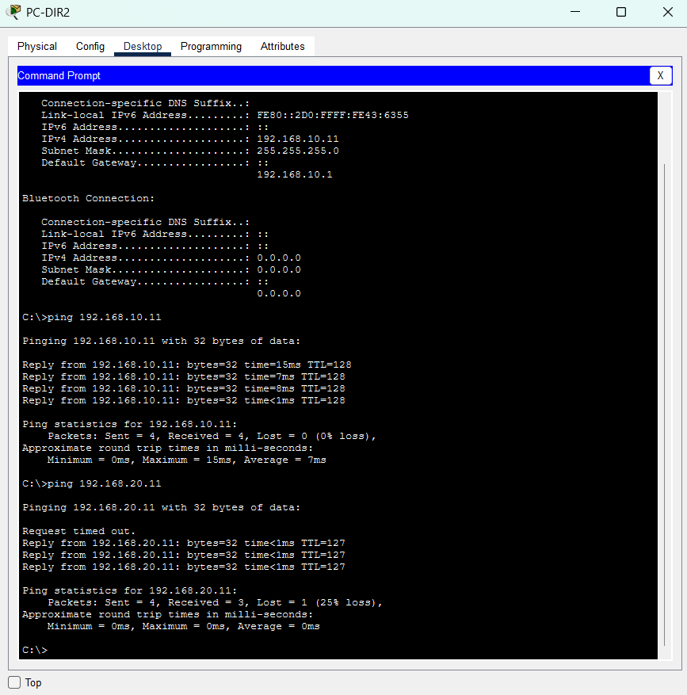
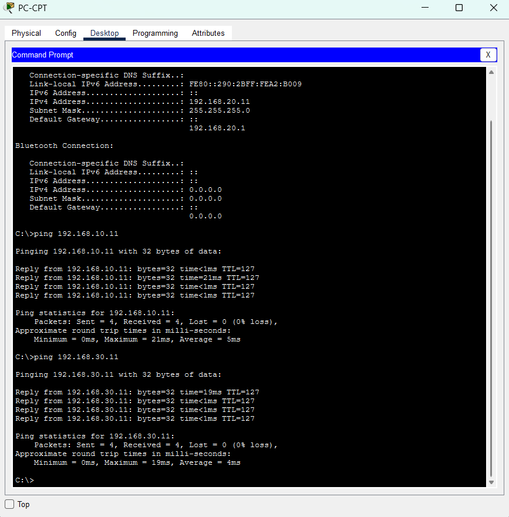
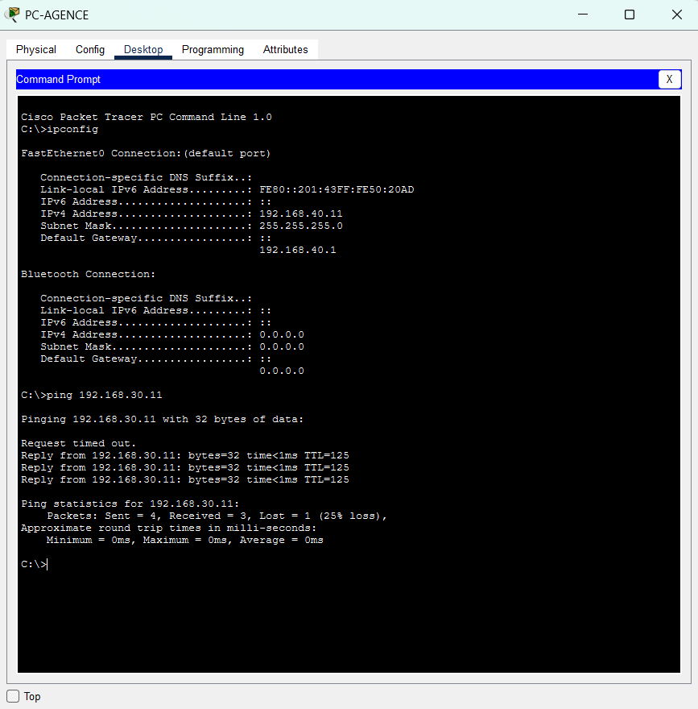

# 07 – Tests de connectivité

## Objectif
Je vérifie que les postes communiquent entre eux : dans un même service, entre les services du siège et entre le siège et l'agence.

## Adresses des postes
| Poste | Adresse |
|---|---|
| `PC-DIR1` | `192.168.10.12` |
| `PC-DIR2` | `192.168.10.11` |
| `PC-CPT` | `192.168.20.11` |
| `PC-INF` | `192.168.30.11` |
| `PC-AGENCE` | `192.168.40.11` |

## Procédure
Pour chaque test : je clique sur le poste, onglet **Desktop**, puis **Command Prompt**. Je tape la commande, j'attends la fin et je vérifie le titre de la fenêtre avant de capturer.

```
ping 192.168.10.11
tracert 192.168.40.11
```

## Résultats
| Depuis | Vers | Résultat | TTL | Preuve |
|---|---|---|---|---|
| `PC-DIR1` | `PC-DIR2` (même VLAN) | 4/4, 0 % de perte | 128 | `07-ping-pc-dir1.png` |
| `PC-DIR2` | `PC-CPT` (Direction → Comptabilité) | 3/4, 25 % de perte | 127 | `07-ping-pc-dir2.png` |
| `PC-CPT` | `PC-DIR2` (Comptabilité → Direction) | 4/4, 0 % de perte | 127 | `07-ping-pc-cpt.png` |
| `PC-CPT` | `PC-INF` (Comptabilité → Informatique) | 4/4, 0 % de perte | 127 | `07-ping-pc-cpt.png` |
| `PC-DIR1` | `PC-AGENCE` (siège → agence), 1ᵉʳ essai | 1/4, 75 % de perte | 125 | `07-ping-pc-dir1.png` |
| `PC-DIR1` | `PC-AGENCE`, 2ᵉ essai | 4/4, 0 % de perte | 125 | `07-ping-pc-dir1.png` |
| `PC-AGENCE` | `PC-INF` (agence → siège) | 3/4, 25 % de perte | 125 | `07-ping-pc-agence.png` |

Le TTL baisse de 1 à chaque équipement de niveau 3 traversé : 128 sans équipement de niveau 3, 127 par `SW-L3`, 125 par `SW-L3`, `R-SIEGE` et `R-AGENCE`.

## Chemin entre le siège et l'agence
`tracert 192.168.40.11` depuis `PC-DIR1` affiche quatre sauts :
| Saut | Adresse | Équipement |
|---|---|---|
| 1 | `192.168.10.1` | `SW-L3` (passerelle du VLAN 10) |
| 2 | `10.0.1.1` | `R-SIEGE` |
| 3 | `10.0.0.2` | `R-AGENCE` |
| 4 | `192.168.40.11` | `PC-AGENCE` |

## Difficultés rencontrées
| Difficulté | Preuve | Ce que j'ai fait |
|---|---|---|
| Mon premier test « même VLAN » pingait l'adresse de `PC-DIR2` depuis `PC-DIR2` lui-même (`TTL=128`) : il ne testait pas le réseau | `07-ping-pc-dir2.png` | Je lis le titre de la fenêtre avant de taper, puis je refais le test depuis `PC-DIR1`. |
| Le 1ᵉʳ ping de `PC-DIR1` vers `192.168.40.11` perd 3 paquets sur 4 | `07-ping-pc-dir1.png` | Je relance le ping : 4 réponses sur 4. |

## Preuves
| Capture | Ce qu'elle montre |
|---|---|
|  | `PC-DIR1` : `ping 192.168.40.11` (1 réponse sur 4, `TTL=125`), `tracert 192.168.40.11` (4 sauts, `Trace complete`), `ping 192.168.10.11` (4 sur 4, `TTL=128`), puis un second `ping 192.168.40.11` (4 sur 4, `TTL=125`). |
|  | `PC-DIR2` : `ping 192.168.10.11`, adresse de `PC-DIR2` lui-même (4 réponses, `TTL=128`), puis `ping 192.168.20.11` (3 réponses sur 4, `TTL=127`). |
|  | `PC-CPT` : `ping 192.168.10.11` (4 sur 4, `TTL=127`), puis `ping 192.168.30.11` (4 sur 4, `TTL=127`). |
|  | `PC-AGENCE` : `ping 192.168.30.11` (3 réponses sur 4, `TTL=125`). |
